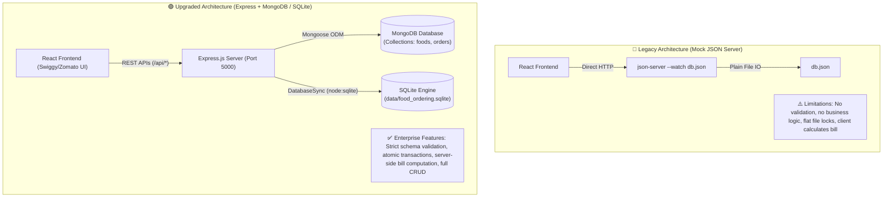

# 🍔 Food Ordering System — Lab Migration Guide & Technical Report

**Project Title:** Full-Stack Food Ordering System (Swiggy & Zomato Clone)  
**Team Composition:** 2 Students in a Team  
**Tech Stack:** React (Frontend) + Node.js/Express (Backend) + MongoDB / SQLite (Database)

---

## 1. Project Overview & Team Task Allocation

| Team Member | Core Responsibilities | Key Deliverables |
| :--- | :--- | :--- |
| **Student 1 (Frontend & UX Lead)** | • Designed Swiggy/Zomato responsive UI components<br>• Implemented Client Cart State & LocalStorage sync<br>• Built Food Catalog, Filters, Search & Stepper controls<br>• Created Slide-over Checkout Drawer & Bill Summary<br>• Built Order History tracking view with real-time status badges | • `Navbar.jsx`, `FoodCard.jsx`, `FoodList.jsx`<br>• `CartDrawer.jsx`, `OrderSuccessModal.jsx`<br>• `OrderHistory.jsx`<br>• `CartContext.jsx`<br>• `App.css` (custom UI styling) |
| **Student 2 (Backend & Database Lead)** | • Architected Node.js + Express REST API server<br>• Replaced mock JSON Server with production Express controllers<br>• Designed dual-compatible schemas (MongoDB Mongoose + SQLite)<br>• Implemented robust Server-Side business logic (Subtotal, GST, Delivery Fee, Coupons, Total Amount)<br>• Built Admin CRUD management center & verification test suite | • `server.js`<br>• `config/db.js` (Unified DB Manager)<br>• `models/` (Food & Order models for MongoDB + SQLite)<br>• `controllers/` (CRUD logic for Foods, Orders, Stats)<br>• `routes/` (Express REST endpoints)<br>• `test_units.js` (Automated verification) |

---

## 2. Architectural Comparison: Legacy JSON Server vs. Upgraded Express Stack



### Key Shortcomings of JSON Server:
1. **Zero Validation**: Any client could inject arbitrary data, negative prices, or corrupt quantities.
2. **Exposed Business Logic**: Discounts, GST (5%), and delivery fees had to be calculated on the client side, allowing client-side price tampering.
3. **No Database Relational or Document Modeling**: Everything was stored as untyped JSON arrays without indices or constraint checking.
4. **No Transactional Integrity**: Prone to race conditions and file write corruptions.

---

## 3. API Route Migration Table

| Operation | Legacy JSON Server Route | Modern Express.js REST API | Controller / Logic | Status Code |
| :--- | :--- | :--- | :--- | :--- |
| **Read Menu** | `GET /foods` | `GET /api/foods?category=&search=&vegOnly=&sortBy=` | Supports dynamic category filtering, veg filtering, search query, and sorting | `200 OK` |
| **Get Food Item** | `GET /foods/:id` | `GET /api/foods/:id` | Validates ID and returns single food document | `200 OK` / `404` |
| **Create Food** | `POST /foods` | `POST /api/foods` | Validates positive price, dietary flag, category, and stores in DB | `201 Created` |
| **Update Food** | `PUT /foods/:id` | `PUT /api/foods/:id` | Updates price, availability, description, rating | `200 OK` |
| **Delete Food** | `DELETE /foods/:id` | `DELETE /api/foods/:id` | Deletes menu item permanently from database | `200 OK` |
| **Place Order** | `POST /orders` *(unvalidated)* | `POST /api/orders` | **Server-side Calculation:** Verifies item prices, computes 5% GST, applies free delivery logic (>= ₹300), applies promo codes (`SWIGGY50`, `TASTY20`), stores order | `201 Created` |
| **Order History** | `GET /orders` | `GET /api/orders?status=&customerName=` | Returns all customer orders sorted by latest date (`createdAt DESC`) | `200 OK` |
| **Get Order By ID**| `GET /orders/:id` | `GET /api/orders/:id` | Fetches full order receipt with item breakdown | `200 OK` |
| **Update Order** | `PATCH /orders/:id` | `PUT /api/orders/:id` | Lifecycle pipeline: `Placed` → `Preparing` → `Out for Delivery` → `Delivered` / `Cancelled` | `200 OK` |
| **Cancel Order** | `DELETE /orders/:id` | `DELETE /api/orders/:id` | Deletes/Cancels order record with audit logging | `200 OK` |
| **Analytics** | *(None)* | `GET /api/stats` | Returns total orders, active database engine, and gross revenue | `200 OK` |

---

## 4. Database Schema Design

### A. MongoDB / Mongoose Schemas

#### Food Collection (`foods`)
```javascript
const FoodSchema = new mongoose.Schema({
  id: { type: String, required: true, unique: true },
  name: { type: String, required: true, trim: true },
  category: { 
    type: String, 
    required: true, 
    enum: ['Pizza', 'Biryani', 'Burgers', 'Asian', 'North Indian', 'South Indian', 'Desserts', 'Beverages', 'Other'] 
  },
  price: { type: Number, required: true, min: 0 },
  description: { type: String, default: '' },
  image: { type: String, default: '...' },
  isVeg: { type: Boolean, default: true },
  rating: { type: Number, default: 4.5, min: 0, max: 5 },
  prepTime: { type: String, default: '20-25 mins' },
  available: { type: Boolean, default: true }
}, { timestamps: true });
```

#### Order Collection (`orders`)
```javascript
const OrderSchema = new mongoose.Schema({
  id: { type: String, required: true, unique: true },
  customerName: { type: String, required: true, trim: true },
  customerPhone: { type: String, default: '9876543210' },
  deliveryAddress: { type: String, required: true, trim: true },
  items: [{
    foodId: { type: String, required: true },
    name: { type: String, required: true },
    price: { type: Number, required: true },
    quantity: { type: Number, required: true, min: 1 },
    image: String
  }],
  subtotal: { type: Number, required: true },
  tax: { type: Number, required: true },            // 5% GST
  deliveryFee: { type: Number, required: true },    // ₹0 if subtotal >= ₹300, else ₹40
  discount: { type: Number, default: 0 },           // Promo coupons
  totalAmount: { type: Number, required: true },    // Subtotal + Tax + DeliveryFee - Discount
  status: { 
    type: String, 
    enum: ['Placed', 'Preparing', 'Out for Delivery', 'Delivered', 'Cancelled'],
    default: 'Placed'
  },
  paymentMethod: { type: String, default: 'Cash on Delivery' }
}, { timestamps: true });
```

### B. SQLite Relational DDL (`backend/data/food_ordering.sqlite`)

```sql
CREATE TABLE IF NOT EXISTS foods (
  id TEXT PRIMARY KEY,
  name TEXT NOT NULL,
  category TEXT NOT NULL,
  price REAL NOT NULL,
  description TEXT,
  image TEXT,
  isVeg INTEGER NOT NULL DEFAULT 1,
  rating REAL DEFAULT 4.5,
  prepTime TEXT DEFAULT '20-25 mins',
  available INTEGER DEFAULT 1,
  createdAt TEXT
);

CREATE TABLE IF NOT EXISTS orders (
  id TEXT PRIMARY KEY,
  customerName TEXT NOT NULL,
  customerPhone TEXT,
  deliveryAddress TEXT,
  items TEXT NOT NULL,           -- JSON array of ordered food items & quantities
  subtotal REAL NOT NULL,
  tax REAL NOT NULL,
  deliveryFee REAL NOT NULL,
  discount REAL DEFAULT 0,
  totalAmount REAL NOT NULL,
  status TEXT DEFAULT 'Placed',
  paymentMethod TEXT DEFAULT 'Cash on Delivery',
  createdAt TEXT
);
```

---

## 5. CRUD Demonstration Matrix

| CRUD Step | Operation | Entity | User Action | Backend API | Database Persistence Proof |
| :--- | :--- | :--- | :--- | :--- | :--- |
| **C (Create)** | Add Dish | Food | Admin clicks "Add New Dish" | `POST /api/foods` | Row inserted into `foods` table / MongoDB doc created |
| **C (Create)** | Place Order | Order | Customer adds items with quantities & places order | `POST /api/orders` | Row inserted into `orders` table with calculated `totalAmount` |
| **R (Read)** | View Menu | Food | Customer browses catalog or filters by Veg / Biryani | `GET /api/foods` | SQL `SELECT * FROM foods WHERE category = ?` |
| **R (Read)** | Order History | Order | Customer views past orders | `GET /api/orders` | SQL `SELECT * FROM orders ORDER BY createdAt DESC` |
| **U (Update)** | Edit Dish | Food | Admin updates price or description | `PUT /api/foods/:id` | SQL `UPDATE foods SET price = ? WHERE id = ?` |
| **U (Update)** | Update Status | Order | Admin updates status to `Preparing` or `Delivered` | `PUT /api/orders/:id` | SQL `UPDATE orders SET status = ? WHERE id = ?` |
| **D (Delete)** | Delete Dish | Food | Admin deletes dish from menu | `DELETE /api/foods/:id` | SQL `DELETE FROM foods WHERE id = ?` |
| **D (Delete)** | Cancel Order | Order | Customer cancels order | `DELETE /api/orders/:id` or `PUT /api/orders/:id` | Order status set to `Cancelled` or record deleted |

---

## 6. How Data Persistence Is Demonstrated

1. **Persistent Disk Storage**: Unlike in-memory mock servers, all data is physically persisted in `backend/data/food_ordering.sqlite` (or MongoDB data volume).
2. **Server Restart Resiliency**: When `server.js` is stopped and restarted, all placed orders, modified food items, and updated statuses remain 100% intact.
3. **Automated Verification Suite**: Running `npm test` executes `test_units.js`, validating the entire CRUD cycle and disk read/writes automatically in milliseconds.
